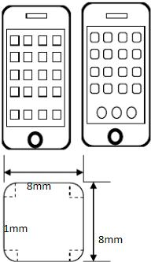

# Mathematics (Grade 6)

**ID**: 1f694b71
**难度**: hard
**题型**: short_answer

## 题目
某触屏智能手机屏幕尺寸为80mm×50mm，原来的主屏幕放置5行×4列共20枚大小一致的正方形图标，边长为8mm．系统升级后，上面的16个正方形图标变成圆角方形图标，其四个圆角是半径为1mm的四分之一圆，下面的四个正方形图标变成半径为4mm的3个圆形图标．则新系统下屏幕除去图标以外剩余部分的面积是多少？(π取3.14)

## 解答

**答案**: 2839.04

1. Step1:计算屏幕的面积，根据长方形面积公式 S = a×b（其中 a = 80mm，b = 50mm），可得屏幕面积为 80×50 = 4000mm²
2. Step2:计算上面一个圆角方形图标的面积，一个圆角方形图标可看作边长 8mm 的正方形减去四个角上多出的部分，四个角上多出部分的面积为边长为(1 + 1)mm 的正方形面积减去半径为 1mm 的圆的面积，即 8×8 - [(1 + 1)² - 3.14×1²] = 64 - [4 - 3.14] = 64 - 0.86 = 63.14mm²
3. Step3:计算上面 16 个圆角方形图标的总面积，为 63.14×16 = 1010.24mm²
4. Step4:计算下面 3 个圆形图标的总面积，根据圆的面积公式 S = πr²（其中 r = 4mm，π = 3.14），可得 3.14×4²×3 = 3.14×16×3 = 50.24×3 = 150.72mm²
5. Step5:计算新系统下屏幕除去图标以外剩余部分的面积，用屏幕面积减去上面 16 个图标和下面 3 个图标的总面积，即 4000 - 1010.24 - 150.72 = 2989.76 - 150.72 = 2839.04mm²

## 知识点

**知识点**:
  - 组合图形的面积．

---
