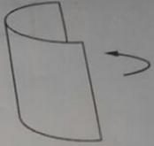

# Mathematics (Grade 6)

**ID**: 24752344
**难度**: hard
**题型**: short_answer

## 题目
王师傅准备将一张长12.56dm、宽15.7dm的铁皮卷成圆柱形状（接缝处不算），再配上一个合适的底面做成一个水桶．这个水桶的容积是多少升？还可能是多少？（结果精确到百分位）

## 解答

**答案**: 197.19, 246.49

1. Step1:当以12.56dm为底面周长，15.7dm为高时，先根据圆的周长公式C = 2πr，求出底面半径r = 12.56÷3.14÷2 = 2dm
2. Step2:再根据圆柱体积公式V = πr²h，计算此时水桶容积V = 3.14×2²×15.7 = 3.14×4×15.7 ≈ 197.19dm³，单位换算为升是197.19升
3. Step3:当以15.7dm为底面周长，12.56dm为高时，根据圆的周长公式C = 2πr，求出底面半径r = 15.7÷3.14÷2 = 2.5dm
4. Step4:根据圆柱体积公式V = πr²h，计算此时水桶容积V = 3.14×2.5²×12.56 = 3.14×6.25×12.56 = 246.49dm³，单位换算为升是246.49升

## 知识点

**知识点**:
  - 

---
