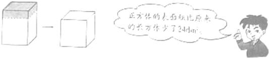

# Mathematics (Grade 6)

**ID**: 2bd0fac3
**难度**: hard
**题型**: short_answer

## 题目
爸爸从一个长方体木块上截下一段长2dm的小长方体后，剩余部分正好是个正方体，如图．求原长方体木块的体积是多少？

## 解答

**答案**: 45

1. Step1:分析可知把长方体截下长2分米的小长方体后，剩下的正方体的表面积比原来减少了4个以正方体的棱长为长，2分米为宽的长方形的面的面积，且减少的表面积为24平方分米
2. Step2:根据长方形面积公式，由减少的表面积24平方分米求出正方体的棱长，即24÷4÷2 = 3分米
3. Step3:因为截下一段长2dm的小长方体后剩余部分是正方体，所以原长方体的长为3 + 2 = 5分米，宽和高与正方体棱长相等，都是3分米
4. Step4:根据长方体体积公式，计算原长方体体积为5×3×3 = 45立方分米

## 知识点

**知识点**:
  - 长方体和正方体的体积．

---
