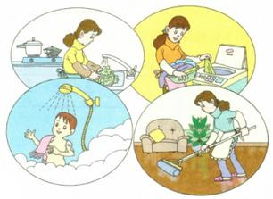

# Mathematics (Grade 6)

**ID**: 322d29be
**难度**: hard
**题型**: short_answer

## 题目
据资料显示，在家庭生活用水中，做饭用水约占$\frac{3}{10}$，洗衣服用水约占$\frac{6}{25}$，洗澡用水约占$\frac{1}{5}$。

（1）做饭、洗衣服、洗澡哪一项用水量最大？
（2）做饭和洗衣服的用水量共约占生活用水总量的几分之几？
（3）除做饭、洗衣服、洗澡用水之外，其他生活用水约占生活用水总量的几分之几？
（4）你还能提出什么问题？

## 解答

**答案**: 做饭, $\frac{27}{50}$, $\frac{13}{50}$, $\frac{11}{25}$

1. Step1:将做饭用水占比$rac{3}{10}$、洗衣服用水占比$rac{6}{25}$、洗澡用水占比$rac{1}{5}$通分，得到$rac{3}{10}=rac{15}{50}$，$rac{6}{25}=rac{12}{50}$，$rac{1}{5}=rac{10}{50}$，比较大小得出$rac{3}{10}>rac{6}{25}>rac{1}{5}$，所以做饭用水量最大，答案为做饭
2. Step2:计算做饭和洗衣服用水量占比之和，即$rac{3}{10}+rac{6}{25}=rac{15}{50}+rac{12}{50}=rac{27}{50}$，答案为$rac{27}{50}$
3. Step3:计算其他生活用水占比，用1减去做饭、洗衣服、洗澡的用水量占比之和，即$1 - (rac{3}{10}+rac{6}{25}+rac{1}{5})=1-rac{37}{50}=rac{13}{50}$，答案为$rac{13}{50}$
4. Step4:提出问题“洗衣服和洗澡的用水量共约占生活用水总量的几分之几？”并计算，$rac{6}{25}+rac{1}{5}=rac{6}{25}+rac{5}{25}=rac{11}{25}$，答案为$rac{11}{25}$

## 知识点

**知识点**:
  - 异分母分数加减法

---
