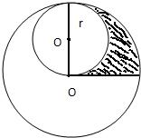

# Mathematics (Grade 6)

**ID**: 3312d59f
**难度**: hard
**题型**: short_answer

## 题目
已知图中阴影部分的面积是25平方厘米，求大圆的面积是多少平方厘米？

## 解答

**答案**: 1971.92

1. Step1:设小圆半径为r，则大圆半径为2r，根据大圆面积的1/4 - 小圆面积的1/2 = 阴影部分面积，列出方程1/4*π*(2r)**2 - 1/2*π*r**2 = 25
2. Step2:对方程1/4*π*(2r)**2 - 1/2*π*r**2 = 25进行化简，得到π*r**2 - 1/2*π*r**2 = 25
3. Step3:继续化简方程π*r**2 - 1/2*π*r**2 = 25，得出1/2*π*r**2 = 25
4. Step4:由1/2*π*r**2 = 25求解r**2，得到r**2 = 50/π
5. Step5:计算大圆面积，大圆面积为π*(2r)**2 = π*4*r**2
6. Step6:将r**2 = 50/π代入π*4*r**2，得到π*4*50/π
7. Step7:计算π*4*50/π = 3.14*200/3.14 = 1971.92

## 知识点

**知识点**:
  - 组合图形的面积．

---
