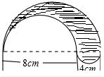

# Mathematics (Grade 6)

**ID**: 364a2696
**难度**: hard
**题型**: short_answer

## 题目
计算图形中阴影部分的周长和面积．

## 解答

**答案**: 37.68, 37.68

1. Step1:计算大圆直径为8 + 4 = 12厘米，根据圆的周长公式C = πd，大圆周长的一半为3.14×12÷2 = 18.84厘米
2. Step2:计算直径为8厘米的小圆周长的一半，根据圆的周长公式C = πd，其值为3.14×8÷2 = 12.56厘米
3. Step3:计算直径为4厘米的小圆周长的一半，根据圆的周长公式C = πd，其值为3.14×4÷2 = 6.28厘米
4. Step4:将上述三个半圆弧长相加，得到阴影部分周长为18.84 + 12.56 + 6.28 = 37.68厘米
5. Step5:计算大圆半径为(8 + 4)÷2 = 6厘米，根据圆的面积公式S = πr²，大圆面积的一半为3.14×6²÷2 = 56.52平方厘米
6. Step6:计算半径为8÷2 = 4厘米的小圆面积的一半，根据圆的面积公式S = πr²，其值为3.14×4²÷2 = 25.12平方厘米
7. Step7:计算半径为4÷2 = 2厘米的小圆面积的一半，根据圆的面积公式S = πr²，其值为3.14×2²÷2 = 6.28平方厘米
8. Step8:用大圆面积的一半减去直径为8厘米的小圆面积的一半再加上直径为4厘米的小圆面积的一半，得到阴影部分面积为56.52 - 25.12 + 6.28 = 37.68平方厘米

## 知识点

**知识点**:
  - 组合图形的面积;圆、圆环的周长

---
