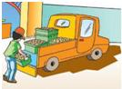

# Mathematics (Grade 6)

**ID**: 37e63dc3
**难度**: hard
**题型**: short_answer

## 题目
超市运来鸡蛋、鸭蛋各12箱，鸡蛋每箱50个，鸭蛋每箱40个．
①超市一共运来多少个鸭蛋？
②运来鸡蛋的个数比运来的鸭蛋多多少个？
③如果8个鸭蛋重1千克，那么超市运来的鸭蛋一共多少千克？

## 解答

**答案**: 480, 120, 60

1. Step1:根据题意，求超市一共运来多少个鸭蛋，用每箱鸭蛋个数40乘箱数12，即40×12 = 480个
2. Step2:先求运来鸡蛋个数，用每箱鸡蛋个数50乘箱数12得50×12 = 600个，再用鸡蛋个数减去鸭蛋个数600 - 480 = 120个，得到运来鸡蛋的个数比鸭蛋多的数量
3. Step3:已知8个鸭蛋重1千克，用鸭蛋总个数480除以8，即480÷8 = 60千克，得到鸭蛋总质量

## 知识点

**知识点**:
  - 整数的乘法及应用;整数的除法及应用

---
