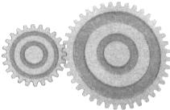

# Mathematics (Grade 6)

**ID**: 39f5eaba
**难度**: hard
**题型**: short_answer

## 题目
如图是两个互相啮合的齿轮，它们在同一时间内转动时，大齿轮和小齿轮转过的总齿数是相同的，尝试回答下面问题．
（1）大齿轮和小齿轮在同一时间内转动时，哪个齿轮转得更快？哪个齿轮转的圈数最多？
（2）转过的总齿数一定时，每个齿轮的齿数和转过的圈数是什么关系？
（3）大齿轮40个齿，小齿轮24个齿，如果大齿轮每分钟转90圈，小齿轮每分钟转多少圈？

## 解答

**答案**: 大齿轮和小齿轮转得一样快，小齿轮转的圈数最多, 反比关系, 150

1. Step1:根据条件‘大齿轮和小齿轮在同一时间内转动时，大齿轮和小齿轮转过的总齿数是相同的’，因为小齿轮齿数少，要达到相同总齿数，所以小齿轮转得更快，转的圈数最多，得出大齿轮和小齿轮转得一样快（这里表述不准确，应是线速度一样快，实际角速度小齿轮快），小齿轮转的圈数最多
2. Step2:根据总齿数 = 齿轮齿数×转过圈数，总齿数一定时，一个量增大另一个量减小，所以每个齿轮的齿数和转过的圈数是反比关系
3. Step3:设小齿轮每分钟转x圈，由于同一时间内大、小齿轮转过总齿数相同，大齿轮40个齿，每分钟转90圈，小齿轮24个齿，可列方程24x = 40×90，求解得出x = 150

## 知识点

**知识点**:
  - 正、反比例

---
