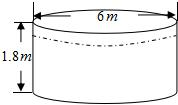

# Mathematics (Grade 6)

**ID**: 3b2b8ad3
**难度**: hard
**题型**: short_answer

## 题目
一个圆柱形水池（如图），池内水面离池口0.3米，如果1立方米水重1吨，
这时水池里的水重多少吨？如果要在这个水池的内壁和底面贴上瓷砖，贴瓷砖的面积是多少平方米？

## 解答

**答案**: 42.39, 62.172

1. Step1:计算水池内水的高度，1.8 - 0.3 = 1.5（米）
2. Step2:计算水池底面半径，6÷2 = 3（米）
3. Step3:根据圆柱体积公式V = πr²h计算水的体积，3.14×3²×1.5 = 3.14×9×1.5 = 42.39（立方米）
4. Step4:计算水的重量，42.39×1 = 42.39（吨）
5. Step5:根据圆的面积公式S = πr²计算水池底面面积，3.14×3² = 28.26（平方米）
6. Step6:根据圆柱侧面积公式S = ch = 2πrh计算水池侧面积，3.14×6×1.8 = 33.912（平方米）
7. Step7:计算贴瓷砖的面积，28.26 + 33.912 = 62.172（平方米）

## 知识点

**知识点**:
  - 圆柱的侧面积、表面积和体积

---
