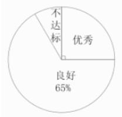

# Mathematics (Grade 6)

**ID**: 42fb42e4
**难度**: hard
**题型**: short_answer

## 题目
上个月市体育锻炼达标抽测，其中某校六年级60米短跑比赛情况如图所示，已知该校六年级得优秀的人数是150人。
（1）这个学校六年级参加抽测的一共有多少人？
（2）其中不达标的有多少人？
（3）针对这次抽测结果，如果你是该校校长，你会有什么想法？

## 解答

**答案**: 600, 60, 增加学生体育锻炼的时间，适当增加锻炼的强度。

1. Step1:由扇形统计图可知优秀部分对应的圆心角为90°，整个圆为360°，则优秀人数占总抽测人数的比例为90÷360，已知优秀人数是150人，根据已知一个数的几分之几是多少求这个数用除法，可得参加抽测的总人数为150÷(90÷360)=600人
2. Step2:先算出达标部分（良好和优秀）所占比例，良好占65%即0.65，优秀占90÷360 = 0.25，那么达标部分共占0.65 + 0.25 = 0.9，所以不达标部分占比为1 - 0.9 = 0.1，用总人数600乘以不达标的占比0.1，可得不达标的人数为600×0.1 = 60人
3. Step3:观察扇形图发现优秀人数占比相对较少，所以从加强学生锻炼角度出发，得出作为校长会增加学生体育锻炼的时间，适当增加锻炼的强度的想法

## 知识点

**知识点**:
  - 扇形统计图

---
