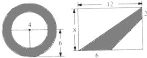

# Mathematics (Grade 6)

**ID**: 432b8924
**难度**: hard
**题型**: short_answer

## 题目
求阴影部分面积( 单位：cm)．

## 解答

**答案**: 100.48, 30

1. Step1:计算左图大圆半径为6cm，小圆半径为4÷2 = 2cm
2. Step2:根据圆面积公式S = πr²，计算左图大圆面积为3.14×6² = 113.04cm²
3. Step3:根据圆面积公式S = πr²，计算左图小圆面积为3.14×2² = 12.56cm²
4. Step4:计算左图阴影部分（圆环）面积为113.04 - 12.56 = 100.48cm²
5. Step5:计算右图长方形面积为12×8 = 96cm²，其一半为96÷2 = 48cm²
6. Step6:计算右图右下方空白直角三角形底为12 - 6 = 6cm，高为8 - 2 = 6cm
7. Step7:根据三角形面积公式S = 底×高÷2，计算右图右下方空白直角三角形面积为6×6÷2 = 18cm²
8. Step8:计算右图阴影部分面积为48 - 18 = 30cm²

## 知识点

**知识点**:
  - 圆、圆环的面积;组合图形的面积．

---
