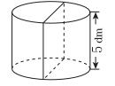

# Mathematics (Grade 6)

**ID**: 48a873de
**难度**: hard
**题型**: short_answer

## 题目
如下图，已知圆柱的高是5dm，过底面圆心垂直切，把圆柱分成相等的两部分，表面积增加了60dm$^{2}$，求圆柱的体积是多少。

## 解答

**答案**: 141.3

1. Step1:根据“过底面圆心垂直切，把圆柱分成相等的两部分，表面积增加了60dm²”，可知增加的是两个以底面直径和高为边长的长方形的面积，所以一个这样的长方形面积为60÷2 = 30dm²
2. Step2:已知长方形面积为30dm²，高是5dm，根据长方形面积公式可求出底面直径为30÷5 = 6dm
3. Step3:由底面直径为6dm，可得底面半径为6÷2 = 3dm
4. Step4:根据圆的面积公式求出圆柱底面积为3.14×3² = 28.26dm²
5. Step5:已知圆柱高为5dm，根据圆柱体积公式V = Sh，可得圆柱体积为28.26×5 = 141.3dm³

## 知识点

**知识点**:
  - 圆柱的应用

---
