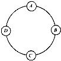

# Mathematics (Grade 6)

**ID**: 4997da2d
**难度**: hard
**题型**: short_answer

## 题目
如图所示，A、B、C、D四个球按顺时针方向均匀分布在周长48米的圆周上，分别以1米/秒、2米/秒、4米/秒的速度做顺时针运动．当有两球碰到一起的时候，两个球相互交换速度，但运行方向不变；当三个球碰到一起的时候，中间球的速度不变，其它两个球相互交换速度．请问：从四个球同时出发开始，经过多少秒四个球第一次同时碰到一起？(不考虑球的半径)．

## 解答

**答案**: 36

1. Step1:分析可知四个球同时碰到一起就是B追上A、C追上A、D追上A同时发生
2. Step2:计算B第一次追上A的时间，根据追及时间 = 追及路程÷速度差，追及路程为48÷4×3 = 36米，速度差为2 - 1 = 1米/秒，所以B第一次追上A用48÷4×3÷(2 - 1)=36秒，以后每48÷(2 - 1)=48秒追上一次，得到B追上A的时间序列为36秒，84秒，132秒，180秒，228秒，276秒，…
3. Step3:计算C第一次追上A的时间，追及路程为48÷4×2 = 24米，速度差为3 - 1 = 2米/秒，C第一次追上A用48÷4×2÷(3 - 1)=12秒，以后每48÷(3 - 1)=24秒追上一次，得到C追上A的时间序列为12秒，36秒，60秒，84秒，108秒，132秒，…
4. Step4:计算D第一次追上A的时间，追及路程为48÷4×1 = 12米，速度差为4 - 1 = 3米/秒，D第一次追上A用48÷4×1÷(4 - 1)=4秒，以后每48÷(4 - 1)=16秒追上一次，得到D追上A的时间序列为4秒，20秒，36秒，52秒，68秒，84秒，…
5. Step5:从上述三个时间序列中找出第一个相同的时间，即36秒，此为四个球第一次同时碰到一起的时间

## 知识点

**知识点**:
  - 逻辑推理．

---
