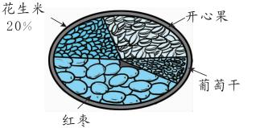

# Mathematics (Grade 6)

**ID**: 4a4862f8
**难度**: hard
**题型**: short_answer

## 题目
下图是亮亮摆出的一个干果拼盘。已知花生米大约占了果盘的20%，你能估计其他几种干果大约各占百分之几吗？

## 解答

**答案**: 10%, 40%, 30%

1. Step1:根据图中信息，可知葡萄干大约是花生米的一半，花生米占果盘的20%，所以葡萄干大约占20%×$\frac{1}{2}$=10%
2. Step2:由图可知红枣和葡萄干大约为整个拼盘的一半，即50%，已求出葡萄干大约占10%，所以红枣大约占50%-10%=40%
3. Step3:因为整个拼盘看作单位“1”，花生米占20%，葡萄干占10%，红枣占40%，所以开心果大约占1-20%-10%-40%＝30%

## 知识点

**知识点**:
  - 估算;百分数的认识;扇形统计图的认识及绘制

---
