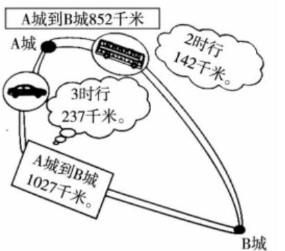

# Mathematics (Grade 6)

**ID**: 4c168e5d
**难度**: hard
**题型**: short_answer

## 题目
谁先到达目的地？

（1）中巴车和小轿车哪辆车行驶得慢一些？
（2）现在每辆车同时从A城出发到B城，小轿车走远路，中巴车走近路，估计一下，哪辆车先到达目的地？
（3）中巴车在实际的行驶途中，因故耽误2小时。算一算，哪辆车先到达目的地？

## 解答

**答案**: 中巴车, 中巴车, 小轿车

1. Step1:计算中巴车速度，142÷2 = 71（千米/时）
2. Step2:计算小轿车速度，237÷3 = 79（千米/时）
3. Step3:比较两车速度，71＜79，得出中巴车行驶得慢一些
4. Step4:计算中巴车走近路到达B城所需时间，852÷71 = 12（小时）
5. Step5:计算小轿车走远路到达B城所需时间，1027÷79 = 13（小时）
6. Step6:比较两车到达B城所需时间，12小时＜13小时，得出中巴车先到达目的地
7. Step7:计算中巴车耽误2小时后实际到达B城所需时间，12 + 2 = 14（小时）
8. Step8:比较中巴车耽误2小时后的实际用时和小轿车用时，14小时＞13小时，得出小轿车先到达目的地

## 知识点

**知识点**:
  - 简单的行程问题

---
