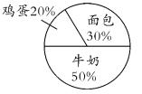

# Mathematics (Grade 6)

**ID**: 4c3dd2c8
**难度**: hard
**题型**: short_answer

## 题目
如图是根据小明今天的早餐制作的统计图：

（1）小明今天的早餐中面包、鸡蛋和牛奶所占量的比是多少？
（2）如果小明今天的早餐吃的鸡蛋和面包一共有120克，他的早餐一共吃了多少克的食物？
（3）小明的妈妈按同样的比大约吃了300克的早餐，请你算一算妈妈今天的早餐各种食物大约分别吃了多少克？
（4）小明的爸爸早餐中面包和鸡蛋的量占了60%，喝了200克的牛奶，小明的爸爸早餐一共吃了多少克的食物？

## 解答

**答案**: 2:3:5, 240, 60, 90, 150, 500

1. Step1:根据扇形统计图中鸡蛋、面包、牛奶所占百分比20%、30%、50%，求它们的比，即20%:30%:50%，化简得到2:3:5，得出第一问答案
2. Step2:已知鸡蛋和面包一共120克，它们所占百分比之和为20% + 30% = 50%，用120除以50%，即120÷(20% + 30%) = 240克，得出第二问答案
3. Step3:妈妈吃的早餐总量为300克，鸡蛋占20%，则鸡蛋的量为300×20% = 60克，得出第三问中鸡蛋的量
4. Step4:妈妈吃的早餐总量为300克，面包占30%，则面包的量为300×30% = 90克，得出第三问中面包的量
5. Step5:妈妈吃的早餐总量为300克，牛奶占50%，则牛奶的量为300×50% = 150克，得出第三问中牛奶的量
6. Step6:爸爸面包和鸡蛋的量占60%，则牛奶占1 - 60% = 40%，已知爸爸喝了200克牛奶，用200除以40%，即200÷(1 - 60%) = 500克，得出第四问答案

## 知识点

**知识点**:
  - 百分数应用题;扇形统计图的认识及绘制

---
