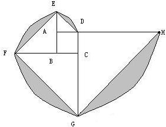

# Mathematics (Grade 6)

**ID**: 4fedf580
**难度**: hard
**题型**: short_answer

## 题目
方形ABCD边长1厘米，分别以A、B、C、D为圆心，以AD、BE、CF、DG为半径画扇形，再分别连接DE、EF、FG、GH．则图中4个弓形面积之和是多少厘米？

## 解答

**答案**: 8.55

1. Step1:明确正方形ABCD边长为1厘米
2. Step2:计算扇形EBF的半径为1 + 1 = 2厘米
3. Step3:计算扇形FCG的半径为2 + 1 = 3厘米
4. Step4:计算扇形GDH的半径为3 + 1 = 4厘米
5. Step5:计算第一个弓形面积，$\frac{1}{4}	imes3.14	imes1^{2}-1	imes1	imes\frac{1}{2}=0.785 - 0.5 = 0.285$平方厘米
6. Step6:计算第二个弓形面积，$\frac{1}{4}	imes3.14	imes2^{2}-2	imes2	imes\frac{1}{2}=3.14 - 2 = 1.14$平方厘米
7. Step7:计算第三个弓形面积，$\frac{1}{4}	imes3.14	imes3^{2}-3	imes3	imes\frac{1}{2}=7.065 - 4.5 = 2.565$平方厘米
8. Step8:计算第四个弓形面积，$\frac{1}{4}	imes3.14	imes4^{2}-4	imes4	imes\frac{1}{2}=12.56 - 8 = 4.56$平方厘米
9. Step9:计算4个弓形面积之和，0.285 + 1.14 + 2.565 + 4.56 = 8.55平方厘米

## 知识点

**知识点**:
  - 组合图形的面积．

---
