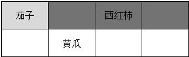

# Mathematics (Grade 6)

**ID**: 53546950
**难度**: hard
**题型**: short_answer

## 题目
王爷爷在一块地里种了三种蔬菜（如图）
（1）种西红柿的地占这块地的几分之几？
（2）种黄瓜和西红柿的地一共占这块地的几分之几？
（3）种黄瓜的地比种茄子的地多几分之几？

## 解答

**答案**: $\frac{3}{8}$, $\frac{7}{8}$, $\frac{3}{8}$

1. Step1:观察图形可知这块地被平均分成8份，其中种西红柿的有3份，根据分数的意义，用种西红柿的份数除以总份数，即3÷8=$\frac{3}{8}$，得到种西红柿的地占这块地的$\frac{3}{8}$
2. Step2:由图知种黄瓜的地占4份，即$\frac{4}{8}$，种西红柿的地占$\frac{3}{8}$，将二者相加，$\frac{4}{8}+\frac{3}{8}=\frac{7}{8}$，得到种黄瓜和西红柿的地一共占这块地的$\frac{7}{8}$
3. Step3:由图知种黄瓜的地占$\frac{4}{8}$，种茄子的地占1份，即$\frac{1}{8}$，用种黄瓜的地所占比例减去种茄子的地所占比例，$\frac{4}{8}-\frac{1}{8}=\frac{3}{8}$，得到种黄瓜的地比种茄子的地多$\frac{3}{8}$

## 知识点

**知识点**:
  - 分数加减法应用题．

---
