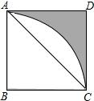

# Mathematics (Grade 6)

**ID**: 56f31d7b
**难度**: hard
**题型**: short_answer

## 题目
如图，正方形ABCD，AC=6cm，求涂色部分面积．

## 解答

**答案**: 3.87

1. Step1:根据正方形面积是它2条对角线乘积的一半，已知AC=6cm，可得正方形面积为6×6÷2 = 18平方厘米
2. Step2:因为正方形边长就是1/4圆的半径，且正方形面积=边长×边长 = 18平方厘米，所以1/4圆的面积为3.14×18×1/4 = 14.13平方厘米
3. Step3:用正方形面积减去1/4圆的面积，即18 - 14.13 = 3.87平方厘米，得到涂色部分面积

## 知识点

**知识点**:
  - 组合图形的面积

---
