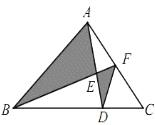

# Mathematics (Grade 6)

**ID**: 5baa8e78
**难度**: hard
**题型**: short_answer

## 题目
已知△ABC面积为5，且BD=2DC，AE=ED，求阴影部分面积．要求写出关键的解题推理过程．

## 解答

**答案**: 2

1. Step1:因为AE=ED，根据等底等高的三角形面积相等，可得$S_{△ABE}=S_{△BED}$，$S_{△AEF}=S_{△DEF}$，从而将阴影部分面积转化为$S_{△BDF}$或$S_{△ABF}$的面积
2. Step2:由于BD=2DC，根据高相等时，三角形面积比等于底边之比，可知$S_{△BDF}=2S_{△CDF}$
3. Step3:设$S_{△CDF}$为1份，则$S_{△BDF}$和$S_{△ABF}$都为2份
4. Step4:计算$S_{△ABC}$的份数为1 + 2 + 2 = 5份
5. Step5:已知$S_{△ABC}$面积为5，可算出1份的面积为5÷5 = 1
6. Step6:因为阴影部分面积为2份，所以阴影部分面积为2×1 = 2

## 知识点

**知识点**:
  - 等积变形(位移、割补)．

---
