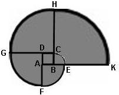

# Mathematics (Grade 6)

**ID**: 5f6545a4
**难度**: hard
**题型**: short_answer

## 题目
如图：正方形ABCD的边长是1厘米，BE=2厘米，求阴影部分的周长是多少厘米？

## 解答

**答案**: 33.26

1. Step1:根据图示及已知条件，计算AE的长度，AE = AB + BE = 1 + 2 = 3厘米
2. Step2:计算DF的长度，DF = AD + AF，因为AF = AE，所以DF = 1 + 3 = 4厘米
3. Step3:计算CG的长度，CG = CD + GD，因为GD = DF，所以CG = 1 + 4 = 5厘米
4. Step4:计算BH的长度，BH = BC + CH，因为CH = CG，所以BH = 1 + 5 = 6厘米
5. Step5:计算半径为3厘米的1/4圆的弧长，l1 = 2×3.14×3×1/4 = 4.71厘米
6. Step6:计算半径为4厘米的1/4圆的弧长，l2 = 2×3.14×4×1/4 = 6.28厘米
7. Step7:计算半径为5厘米的1/4圆的弧长，l3 = 2×3.14×5×1/4 = 7.85厘米
8. Step8:计算半径为6厘米的1/4圆的弧长，l4 = 2×3.14×6×1/4 = 9.42厘米
9. Step9:已知EK = 5厘米
10. Step10:计算阴影部分的周长，C = l1 + l2 + l3 + l4 + 5 = 4.71 + 6.28 + 7.85 + 9.42 + 5 = 33.26厘米

## 知识点

**知识点**:
  - 巧算周长．

---
