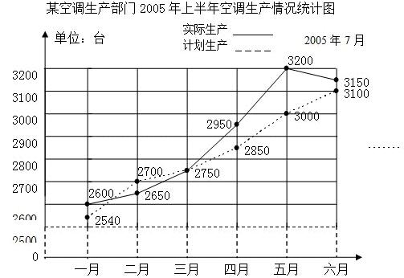

# Mathematics (Grade 6)

**ID**: 603cd7dc
**难度**: hard
**题型**: short_answer

## 题目
某空调生产部门2005年上半年空调产量如图：

(1)哪个月的产量比原计划低？比原计划低百分之几？
(2)哪几个月超额完成任务？各超出多少台？
(3)五月的实际产量超过计划产量的百分之几？
(4)三月的实际产量占计划产量的百分之几？

## 解答

**答案**: 2月, 1.85%, 1、4、5、6月, 60、100、200、50台, 6.67%, 100%

1. Step1:观察统计图，发现2月的实际产量（2650台）对应的实线低于计划产量（2700台）对应的虚线，所以确定2月的产量比原计划低
2. Step2:计算2月比原计划低的百分比，根据公式(计划产量 - 实际产量)÷计划产量×100%，即(2700 - 2650)÷2700×100% = 50÷2700×100%≈1.85%
3. Step3:观察统计图，发现1月（实际2600台，计划2540台）、4月（实际2950台，计划2850台）、5月（实际3200台，计划3000台）、6月（实际3150台，计划3100台）的实际产量对应的实线高于计划产量对应的虚线，所以确定1、4、5、6月超额完成任务
4. Step4:分别计算1、4、5、6月超出的台数，1月：2600 - 2540 = 60台；4月：2950 - 2850 = 100台；5月：3200 - 3000 = 200台；6月：3150 - 3100 = 50台
5. Step5:计算五月的实际产量超过计划产量的百分比，根据公式(实际产量 - 计划产量)÷计划产量×100%，即(3200 - 3000)÷3000×100% = 200÷3000×100%≈6.67%
6. Step6:计算三月的实际产量占计划产量的百分比，根据公式实际产量÷计划产量×100%，即2750÷2750×100% = 1×100% = 100%

## 知识点

**知识点**:
  - 复式折线统计图;百分数的实际应用．

---
