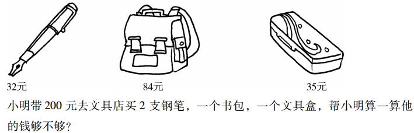

# Mathematics (Grade 6)

**ID**: 623a8601
**难度**: hard
**题型**: short_answer

## 题目

钢笔：32元
书包：84元
文具盒：35元
小明带200元去文具店买2支钢笔，一个书包，一个文具盒，帮小明算一算他的钱够不够？

## 解答

**答案**: 183, 200

1. Step1:计算2支钢笔的价格，根据“总价=单价×数量”，钢笔单价为32元，数量为2支，可得2×32 = 64元
2. Step2:计算购买一个书包和一个文具盒的总价格，书包价格84元，文具盒价格35元，84 + 35 = 119元
3. Step3:计算购买2支钢笔、一个书包和一个文具盒的总价格，将2支钢笔的价格与书包和文具盒的总价格相加，64 + 119 = 183元
4. Step4:将总价格183元与小明带的200元进行比较，得出183元＜200元

## 知识点

**知识点**:
  - 整数复合应用题

---
