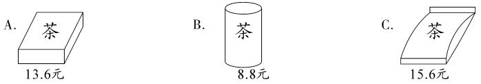

# Mathematics (Grade 6)

**ID**: 662bee3e
**难度**: hard
**题型**: short_answer

## 题目
解决问题。
有三种不同包装的茶叶。

（1）如果要买A和B两种茶叶，需要多少元？
（2）C包装的茶叶比B包装的茶叶贵多少元？

## 解答

**答案**: 22.4, 6.8

1. Step1:明确问题（1）是求A和B两种茶叶价格的总和，A包装茶叶价格为13.6元，B包装茶叶价格为8.8元，根据加法意义，列出算式13.6 + 8.8
2. Step2:计算13.6 + 8.8，先把小数点对齐，再按整数加法计算，得到22.4元，此为问题（1）答案
3. Step3:明确问题（2）是求C包装茶叶比B包装茶叶贵的金额，C包装茶叶价格为15.6元，B包装茶叶价格为8.8元，根据减法意义，列出算式15.6 - 8.8
4. Step4:计算15.6 - 8.8，先把小数点对齐，再按整数减法计算，得到6.8元，此为问题（2）答案

## 知识点

**知识点**:
  - 小数的加法和减法

---
