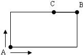

# Mathematics (Grade 6)

**ID**: 68031291
**难度**: hard
**题型**: short_answer

## 题目
客车和货车同时从A站出发向两个不同方向行驶，4小时后在C站相遇（如图所示，四边形是长方形），已知B、C两站相距18千米，客车速度比货车速度快$\frac{1}{6}$．货车每小时行多少千米？客车呢？

## 解答

**答案**: 54, 63

1. Step1:根据已知条件，两车4小时后在C站相遇，B、C两站相距18千米，因为客车和货车是向不同方向行驶且四边形是长方形，所以客车比货车多跑的路程为18×2 = 36千米
2. Step2:设货车的速度是x千米，由于客车速度比货车速度快$\frac{1}{6}$，所以客车速度为x + $\frac{1}{6}$x = $\frac{7}{6}$x千米
3. Step3:依据路程 = 速度×时间，可得货车行驶的路程为4x千米，客车行驶的路程为$\frac{7}{6}$x×4千米
4. Step4:根据客车比货车多跑36千米，可列方程为（$\frac{7}{6}$x×4 - 4x）= 36
5. Step5:解方程$\frac{7}{6}$x×4 - 4x = 36，先计算$\frac{7}{6}$x×4 - 4x = $\frac{28}{6}$x - 4x = $\frac{28}{6}$x - $\frac{24}{6}$x = $\frac{4}{6}$x = $\frac{2}{3}$x，即$\frac{2}{3}$x = 36，解得x = 36÷$\frac{2}{3}$ = 54，所以货车速度是54千米/小时
6. Step6:把x = 54代入客车速度表达式x + $\frac{1}{6}$x，可得客车速度为54 + 54×$\frac{1}{6}$ = 54 + 9 = 63千米/小时

## 知识点

**知识点**:
  - 简单的行程问题．

---
