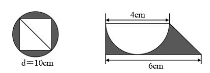

# Mathematics (Grade 6)

**ID**: 6a53b1ca
**难度**: hard
**题型**: short_answer

## 题目
求阴影部分的面积。 

## 解答

**答案**: 28.5, 3.72

1. Step1:计算第一幅图中圆的半径，10÷2 = 5厘米
2. Step2:根据圆的面积公式S = πr²，计算第一幅图中圆的面积，3.14×5² = 78.5平方厘米
3. Step3:计算第一幅图中三角形的底为10厘米，高为10÷2 = 5厘米
4. Step4:计算第一幅图中2个三角形的面积，10×5÷2×2 = 50平方厘米
5. Step5:计算第一幅图中阴影部分的面积，78.5 - 50 = 28.5平方厘米
6. Step6:计算第二幅图中半圆的半径，4÷2 = 2厘米
7. Step7:计算第二幅图中梯形的上底为4厘米，下底为6厘米，高为4÷2 = 2厘米
8. Step8:根据梯形面积公式S = (a + b)h÷2，计算第二幅图中梯形的面积，(4 + 6)×2÷2 = 10平方厘米
9. Step9:根据圆的面积公式S = πr²，计算第二幅图中半圆的面积，3.14×2²÷2 = 6.28平方厘米
10. Step10:计算第二幅图中阴影部分的面积，10 - 6.28 = 3.72平方厘米

## 知识点

**知识点**:
  - 

---
