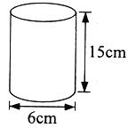

# Mathematics (Grade 6)

**ID**: 6e1148df
**难度**: hard
**题型**: short_answer

## 题目
贝贝家来了3位客人，贝贝拿出20ml浓缩果汁按1：50的比给客人冲果汁喝，用如下图的玻璃杯，果汁倒至$\frac{2}{3}$处，贝贝和客人每人一杯够吗？

## 解答

**答案**: 1020, 1130.4

1. Step1:计算20ml浓缩果汁按1：50的比例可配成的果汁总体积，根据公式可得20×(50 + 1)=1020ml
2. Step2:由图可知玻璃杯底面直径为6cm，则半径为6÷2 = 3cm，高为15cm，计算每个玻璃杯倒至$rac{2}{3}$处的果汁体积，根据圆柱体积公式$V = \pi r^{2}h$可得$\pi×3^{2}×15×rac{2}{3}$
3. Step3:计算4个玻璃杯倒至$rac{2}{3}$处的果汁总体积，即$\pi×3^{2}×15×rac{2}{3}×4 = 1130.4$立方厘米，因为1立方厘米 = 1ml，所以也是1130.4ml

## 知识点

**知识点**:
  - 比的认识;比与分数、除法的关系;比的性质;比例的意义和基本性质

---
