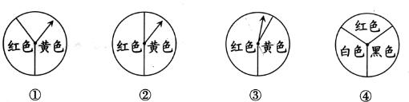

# Mathematics (Grade 6)

**ID**: 6fa52abe
**难度**: hard
**题型**: short_answer

## 题目
杉杉和轩轩用转盘做游戏，指针停在红色区域算杉杉赢，停在黄色区域算轩轩赢．

(1)杉杉用几号转盘，赢的可能性大一些？
(2)轩轩用几号转盘，赢的可能性大一些？
(3)用几号转盘最公平？

## 解答

**答案**: 3, 1, 2

1. Step1:分析问题(1)，要使杉杉赢的可能性大，需红色区域面积大，观察发现③号转盘红色面积较大，所以问题(1)答案是③
2. Step2:分析问题(2)，要使轩轩赢的可能性大，需黄色区域面积大，观察发现①号转盘黄色面积较大，所以问题(2)答案是①
3. Step3:分析问题(3)，要使游戏公平，需红色和黄色区域面积一样大，观察发现②号转盘黄色和红色面积各占圆形面积的$rac{1}{2}$，所以问题(3)答案是②
4. Step4:将答案整理为列表['3', '1', '2']

## 知识点

**知识点**:
  - 可能性的大小;游戏规则的公平性．

---
