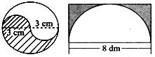

# Mathematics (Grade 6)

**ID**: 6fc312a1
**难度**: hard
**题型**: short_answer

## 题目
求图中阴影部分的周长和面积．
 。

## 解答

**答案**: 18.84, 14.13, 28.56, 6.88

1. Step1:计算第一个图中阴影部分的周长，根据解析2可知其等于半径为3厘米的半圆的弧长与直径为3厘米的圆的周长的和，即3.14×3×2÷2+3.14×3 = 9.42+9.42 = 18.84厘米
2. Step2:计算第一个图中阴影部分的面积，由解析2可知其等于半径3厘米的半圆的面积，即3.14×3²÷2 = 3.14×9÷2 = 14.13平方厘米
3. Step3:计算第二个图中阴影部分的周长，根据解析2可知其等于长方形的2条宽与一条长的和，再加上直径8分米的半圆的弧长，长方形长8分米，宽为8÷2 = 4分米，所以周长为8+4×2+3.14×8÷2 = 16+12.56 = 28.56分米
4. Step4:计算第二个图中阴影部分的面积，由解析2可知其等于长方形的面积与半圆的面积之差，长方形面积为8×4 = 32平方分米，半圆面积为3.14×(8÷2)²÷2 = 3.14×16÷2 = 25.12平方分米，所以面积为32 - 25.12 = 6.88平方分米

## 知识点

**知识点**:
  - 圆、圆环的周长;圆、圆环的面积;组合图形的面积．

---
