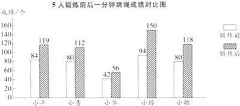

# Mathematics (Grade 6)

**ID**: 75580a42
**难度**: hard
**题型**: short_answer

## 题目
为准备参加跳绳比赛，小平、小青、小华、小玲、小敏在1个月前就开始积极锻炼．
（1）锻炼前，跳的最多的与最少的相差多少个？锻炼后，跳的最多的与最少的相差多少个？
（2）锻炼前后，5人一分钟跳绳的平均成绩分别是多少？
（3）为什么锻炼前后有的成绩提高快，有的成绩提高慢？谈谈你的看法．

## 解答

**答案**: 52, 94, 101.5, 96, 49, 122, 99, 每个人的基础不同，努力的程度不一样，用在锻炼上的时间不一样，所以有的成绩提高快，有的成绩提高慢．

1. Step1:观察图表，确定浅颜色代表锻炼前，深颜色代表锻炼后
2. Step2:找出锻炼前跳的最多的是小玲94个，最少的是小华42个，计算差值94 - 42 = 52个
3. Step3:找出锻炼后跳的最多的是小玲150个，最少的是小华56个，计算差值150 - 56 = 94个
4. Step4:计算小平锻炼前后的平均成绩，(84 + 119)÷2 = 101.5个
5. Step5:计算小青锻炼前后的平均成绩，(80 + 112)÷2 = 96个
6. Step6:计算小华锻炼前后的平均成绩，(42 + 56)÷2 = 49个
7. Step7:计算小玲锻炼前后的平均成绩，(94 + 150)÷2 = 122个
8. Step8:计算小敏锻炼前后的平均成绩，(80 + 118)÷2 = 99个
9. Step9:分析成绩提高快慢原因，得出每个人的基础不同，努力的程度不一样，用在锻炼上的时间不一样，所以有的成绩提高快，有的成绩提高慢

## 知识点

**知识点**:
  - 两种不同形式的复式条形统计图；从统计图表中获取信息；统计结果的解释和据此作出的判断和预测．

---
