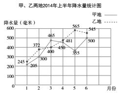

# Mathematics (Grade 6)

**ID**: 77c03a10
**难度**: hard
**题型**: short_answer

## 题目
下面是甲地和乙地2014年上半年每月降水量的折线统计图。

根据折线统计图，完成下面各题。
（1）甲地2014年上半年平均每月降水量是多少毫米？（得数保留整数）
（2）乙地6月份降水量比5月份少百分之几？（百分号前保留一位小数）
（3）甲、乙两地哪个月的降水量相差最大？相差多少毫米？

## 解答

**答案**: 379, 3.5%, 210

1. Step1:计算甲地2014年上半年平均每月降水量，先将甲地1 - 6月降水量相加：205 + 300 + 465 + 450 + 355 + 500 = 2275毫米，再除以6，2275÷6≈379毫米
2. Step2:计算乙地6月份降水量比5月份少的百分比，先求出6月比5月少的降水量：565 - 545 = 20毫米，再除以5月份降水量，20÷565≈3.5%
3. Step3:找出甲、乙两地降水量相差最大的月份为5月，计算相差降水量：565 - 355 = 210毫米

## 知识点

**知识点**:
  - 复式折线统计图

---
