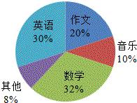

# Mathematics (Grade 6)

**ID**: 7a784dcb
**难度**: hard
**题型**: short_answer

## 题目
五(2)班有学生50人，某同学对全班同学参加兴趣小组的情况作了调查(每人只能参加一个兴趣小组)，统计图如图所示．
①参加兴趣小组的各有多少人？
②提出一个用百分数解答的问题，并解答．

## 解答

**答案**: 15(人), 10(人), 5(人), 16(人), 8(人), 50%

1. Step1:计算英语小组人数，用总人数50乘英语小组占比30%，即50×30%=15(人)
2. Step2:计算作文小组人数，用总人数50乘作文小组占比20%，即50×20%=10(人)
3. Step3:计算音乐小组人数，用总人数50乘音乐小组占比10%，即50×10%=5(人)
4. Step4:计算数学小组人数，用总人数50乘数学小组占比32%，即50×32%=16(人)
5. Step5:计算其它小组人数，用总人数50乘其它小组占比8%，即50×8%=8(人)
6. Step6:提出问题“参加英语小组的人数比参加作文小组的人数多百分之几”，先算人数差15 - 10 = 5，再除以作文小组人数10，即(15 - 10)÷10 = 5÷10 = 0.5 = 50%

## 知识点

**知识点**:
  - 扇形统计图;“提问题”、“填条件”应用题;百分数的实际应用．

---
