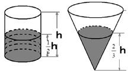

# Mathematics (Grade 6)

**ID**: 802804b3
**难度**: hard
**题型**: short_answer

## 题目
将如图中的圆柱容器的底部和圆锥形容器的顶点处钻个孔．同时把容器盛满水，38分钟后，圆柱形容器中水面高度还剩原来的$\frac{1}{2}$，圆锥形容器中水面的高度剩下原来的$\frac{2}{3}$．圆柱形容器中水漏完时是10：20，圆锥形容器中的水是什么时刻漏完的？

## 解答

**答案**: 9:58

1. Step1:因为圆柱上下等粗，水面高度降到$rac{1}{2}$需38分钟，所以圆柱水全部漏完需38×2 = 76分钟
2. Step2:已知圆柱形容器中水漏完时是10：20，所以开始漏水时刻为10时20分 - 76分 = 9时04分
3. Step3:圆锥总体积是$rac{1}{3}$πr$^{2}$h，下面小锥体的体积是$rac{1}{3}$π$(rac{2}{3}r)^{2}rac{2}{3}$h
4. Step4:计算下面小锥体的体积与上面38分钟漏下的水的体积比，即$rac{1}{3}$π$(rac{2}{3}r)^{2}rac{2}{3}$h：[$rac{1}{3}$πr$^{2}$h - $rac{1}{3}$π$(rac{2}{3}r)^{2}rac{2}{3}$h]=8：19
5. Step5:根据上述比例，计算圆锥形容器中剩余水漏完还需时间为38×$rac{8}{19}$ = 16分钟
6. Step6:计算圆锥形容器中的水漏完时刻为9时04分 + 38分 + 16分 = 9时58分

## 知识点

**知识点**:
  - 比的应用．

---
