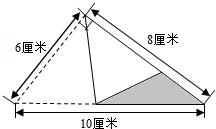

# Mathematics (Grade 6)

**ID**: 847d36d1
**难度**: hard
**题型**: short_answer

## 题目
如图所示，将直角三角形中的短直角边，通过折叠重合到长直角边上，则图中阴影部分的面积（未重叠部分）是多少平方厘米？

## 解答

**答案**: $\\frac{24}{7}$

1. Step1:根据全等三角形的定义，可知折叠后重合的三角形1和三角形2是全等三角形，所以它们面积相等
2. Step2:因为三角形2和三角形3的高相等，三角形2的底边为6厘米，三角形3的底边为8 - 6 = 2厘米，根据高一定时，三角形的面积与底成正比例的性质，可得三角形2的面积：三角形3的面积 = 6：2 = 3：1
3. Step3:设三角形3的面积是x平方厘米，由于三角形2的面积：三角形3的面积 = 3：1，所以三角形2和三角形1的面积都是3x平方厘米
4. Step4:原直角三角形的面积为6×8÷2平方厘米，而原直角三角形的面积又等于三角形1、三角形2和三角形3的面积之和，即x + 3x + 3x = 6×8÷2
5. Step5:化简方程x + 3x + 3x = 6×8÷2得7x = 24
6. Step6:求解方程7x = 24，可得x = 24÷7 = $\\frac{24}{7}$，即阴影部分（三角形3）的面积是$\\frac{24}{7}$平方厘米

## 知识点

**知识点**:
  - 相似三角形的性质（份数、比例）

---
