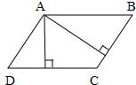

# Mathematics (Grade 6)

**ID**: 87632e2b
**难度**: hard
**题型**: short_answer

## 题目
平行四边形ABCD的周长是102厘米，以CD为底时，高为14厘米；以BC为底时，高为20厘米，求平行四边形的面积．

## 解答

**答案**: 420

1. Step1:计算CD边上的高与BC边上的高的比为14:20=7/10
2. Step2:根据高的比等于底的反比，可知BC与CD的比为7/10
3. Step3:因为平行四边形对边相等，周长是102厘米，所以BC + CD = 102÷2 = 51厘米
4. Step4:把CD看作单位'1'，则BC是7/10，那么CD的长度为51÷(1 + 7/10)=30厘米
5. Step5:根据平行四边形面积公式，以CD为底，高为14厘米，面积为30×14 = 420平方厘米

## 知识点

**知识点**:
  - 平行四边形的面积．

---
