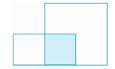

# Mathematics (Grade 6)

**ID**: 8e505069
**难度**: hard
**题型**: short_answer

## 题目
一个长方形与一个大正方形如图那样重叠， 长方形面积的$\frac{1}{2}$等于大正方形面积的$\frac{1}{4}$，求这两个图形的面积比。

## 解答

**答案**: 1:2

1. Step1:根据题意可知，重叠部分的面积等于长方形面积的$\frac{1}{2}$，即重叠部分面积 = $\frac{1}{2}$×长方形面积
2. Step2:同时重叠部分的面积等于大正方形面积的$\frac{1}{4}$，即重叠部分面积 = $\frac{1}{4}$×大正方形面积
3. Step3:由上述两个等式可得$\frac{1}{2}$×长方形面积 = $\frac{1}{4}$×大正方形面积
4. Step4:根据比例的性质，由$\frac{1}{2}$×长方形面积 = $\frac{1}{4}$×大正方形面积可推出长方形面积:大正方形面积 = $\frac{1}{4}$:$\frac{1}{2}$
5. Step5:化简$\frac{1}{4}$:$\frac{1}{2}$，得到1:2

## 知识点

**知识点**:
  - 分数乘法应用题;比例的意义和基本性质

---
