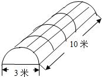

# Mathematics (Grade 6)

**ID**: 8f165b65
**难度**: hard
**题型**: short_answer

## 题目
如图是小明的爸爸打算盖的大棚的示意图，请问：
（1）盖一个这样的大棚至少需要塑料薄膜多少平方米？
（2）这个大棚的占地面积有多大？
（3）这个大棚内的空间有多大？

## 解答

**答案**: 47.1, 30, 35.325

1. Step1:根据圆柱侧面积公式，先计算底面周长为3.14×3，再乘以高10得到侧面积为3.14×3×10，然后除以2，即3.14×3×10÷2 = 47.1，得到盖大棚所需塑料薄膜面积。
2. Step2:根据长方形面积公式，长为10米，宽为3米，计算10×3 = 30，得到大棚占地面积。
3. Step3:先计算底面半径为3÷2，根据圆柱体积公式，底面积为3.14×(3÷2)**2，再乘以高10得到体积为3.14×(3÷2)**2×10，然后除以2，即3.14×(3÷2)**2×10÷2 = 35.325，得到大棚内空间大小。

## 知识点

**知识点**:
  - 关于圆柱的应用题

---
