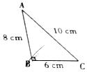

# Mathematics (Grade 6)

**ID**: 9354327d
**难度**: hard
**题型**: short_answer

## 题目
有一个直角三角形ABC如图所示（三条边的长度在图中标出）．
（1）将三角形ABC绕B点旋转一周，求斜边AC扫过的区域的面积；
（2）将三角形ABC绕斜边AC旋转一周，求三角形旋转得到的立体图形的体积．

## 解答

**答案**: 87.92, 241.152

1. Step1:分析（1），三角形ABC绕B点旋转一周，斜边AC扫过的区域是环形，根据环形面积公式S=π（R² - r²），其中R为AB的长度8cm，r为BC的长度6cm
2. Step2:计算（1）中环形面积，代入数据得3.14×8² - 3.14×6² = 200.96 - 113.04 = 87.92平方厘米
3. Step3:分析（2），直角三角形绕斜边旋转一周得到的图形是有公共底的两个圆锥组成图形，两个圆锥高的和等于斜边AC的长10cm，先求圆锥底面半径，根据直角三角形面积的两种算法求出斜边上的高即圆锥底面半径，为6×8÷10 = 4.8cm
4. Step4:根据圆锥体积公式V = $\frac{1}{3}$πr²h，计算（2）中立体图形体积，V = $\frac{1}{3}$π×（6×8÷10）²×10 = $\frac{1}{3}$π×4.8×4.8×10 = 1.6×48×3.14 = 241.152立方厘米

## 知识点

**知识点**:
  - 关于圆锥的应用题

---
