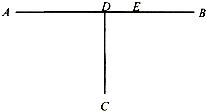

# Mathematics (Grade 6)

**ID**: 9928b30a
**难度**: hard
**题型**: short_answer

## 题目
如图，A、B两地相距54千米，D是AB的中点．甲、乙、丙三人骑车分别同时从A、B、C三地出发，甲骑车去B地，乙骑车去A地，丙总是经过D之后往甲、乙两人将要相遇的地方骑，结果三人在距离D点5400米的E点相遇．如果乙的速度提高到原来的3倍，那么丙必须提前52分钟出发三人才能相遇，否则甲、乙相遇的时候，丙还差6600米才到D．请问：甲的速度是每小时多少千米？

## 解答

**答案**: 21.6

1. Step1:计算AB中点D到A、B的距离，AD = DB = 54÷2 = 27千米，将5400米换算为5.4千米，得出AE = 27 + 5.4 = 32.4千米，BE = 27 - 5.4 = 21.6千米
2. Step2:根据甲乙相遇时所走路程比等于速度比，得出甲乙速度比为AE/BE = 32.4/21.6 = 3/2，设甲的速度为x千米/小时，则乙的速度为(2/3)x千米/小时
3. Step3:当乙速度提高到原来的3倍时，计算新的甲乙速度比为x/(3×(2/3)x)=1/2，得出相遇点F到A的距离AF = 54÷(1 + 2)=18千米
4. Step4:计算DF = 27 - 18 = 9千米，因为丙提前52分钟出发三人才能相遇，否则甲、乙相遇时丙还差6600米（即6.6千米）才到D，所以丙52分钟走的路程为6.6 + 9千米，将52分钟换算为52/60小时，计算丙的速度为(6.6 + 9)÷(52/60)=18千米/小时
5. Step5:根据甲和丙在E点相遇，利用时间相等列出等式EF/甲速 = (DE + 6.6)/丙速，其中EF = 5.4 + 9千米，DE = 5.4千米，丙速为18千米/小时，即(5.4 + 9)/x=(5.4 + 6.6)/18
6. Step6:求解方程(5.4 + 6.6)x=(5.4 + 9)×18，得出12x = 14.4×18，12x = 259.2，解得x = 21.6千米/小时

## 知识点

**知识点**:
  - 相遇问题．

---
