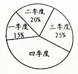

# Mathematics (Grade 6)

**ID**: 9b810d82
**难度**: hard
**题型**: short_answer

## 题目
如图是某工厂2014年完成产值情况统计图．
（1）已知第三季度比第一季度多完成产值50万元，全年完成产值多少万元？
（2）第四季度完成产值多少万元？

## 解答

**答案**: 1000, 400

1. Step1:计算第三季度比第一季度多完成产值的比率，25% - 15% = 10%
2. Step2:已知第三季度比第一季度多完成产值50万元，用50万元除以多完成产值的比率10%，即50÷10% = 1000万元，得到全年完成产值
3. Step3:计算第四季度完成产值占全年的比率，1 - 15% - 20% - 25% = 40%
4. Step4:用全年完成产值1000万元乘以第四季度完成产值占比40%，即1000×40% = 400万元，得到第四季度完成产值

## 知识点

**知识点**:
  - 扇形统计图

---
