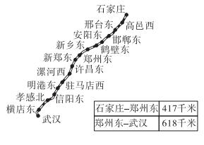

# Mathematics (Grade 6)

**ID**: 9e46e2da
**难度**: hard
**题型**: short_answer

## 题目
刘阿姨家住石家庄，春节乘火车回武汉老家，途径郑州，最后到达武汉。
1.石家庄到武汉的路程是多少千米？
2.火车从石家庄出发，平均每小时行驶315千米，行驶3小时到武汉了么？

## 解答

**答案**: 1035, 没有到达武汉

1. Step1:根据题意可知从石家庄到武汉途径郑州，需将石家庄 - 郑州东的417千米与郑州东 - 武汉的618千米相加，即417 + 618 = 1035千米，得到石家庄到武汉的路程
2. Step2:已知火车平均每小时行驶315千米，根据路程 = 速度×时间，计算行驶3小时的路程为315×3 = 945千米
3. Step3:比较3小时行驶的路程945千米和石家庄到武汉的路程1035千米，因为945＜1035，所以得出行驶3小时没有到达武汉

## 知识点

**知识点**:
  - 进位加法;多位数的乘法;简单的行程问题

---
