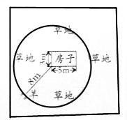

# Mathematics (Grade 6)

**ID**: a4eb050c
**难度**: hard
**题型**: short_answer

## 题目
草地的中心有一座房子，房子底面的长是5m，宽是3m．主人将羊拴在房子的一个角（如图），如果拴羊的绳长是8m，羊能吃到草的面积最大是多少？

## 解答

**答案**: 177.41

1. Step1:分析羊吃草的范围，可知由三部分组成，第一部分是半径为8米，圆心角为360° - 90° = 270°的扇形
2. Step2:计算第一部分面积，根据扇形面积公式，可得$rac{270}{360}$×3.14×8² = $rac{3}{4}$×3.14×64 = 150.72平方米
3. Step3:确定第二部分是半径为8 - 5 = 3米的$rac{1}{4}$圆
4. Step4:计算第二部分面积，根据圆的面积公式，可得$rac{1}{4}$×3.14×3² = $rac{1}{4}$×3.14×9 = 7.065平方米
5. Step5:确定第三部分是半径为8 - 3 = 5米的$rac{1}{4}$圆
6. Step6:计算第三部分面积，根据圆的面积公式，可得$rac{1}{4}$×3.14×5² = $rac{1}{4}$×3.14×25 = 19.625平方米
7. Step7:将三部分面积相加，150.72 + 7.065 + 19.625 = 177.41平方米

## 知识点

**知识点**:
  - 圆、圆环的面积

---
