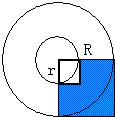

# Mathematics (Grade 6)

**ID**: a710559d
**难度**: hard
**题型**: short_answer

## 题目
(2012•庄浪县模拟)已知图中阴影部分的面积是40平方厘米，求环形的面积是多少平方厘米？( π取3.14)

## 解答

**答案**: 125.6

1. Step1:设大圆半径为R，小圆半径为r，可得大正方形边长为R，小正方形边长为r
2. Step2:根据阴影部分面积等于大正方形面积减去小正方形面积，得出阴影部分面积为R² - r²，已知其值为40平方厘米
3. Step3:因为环形面积等于大圆面积减去小圆面积，即πR² - πr² = π(R² - r²)
4. Step4:把R² - r² = 40平方厘米，π = 3.14代入环形面积公式，得到环形面积为3.14×40 = 125.6平方厘米

## 知识点

**知识点**:
  - 组合图形的面积．

---
