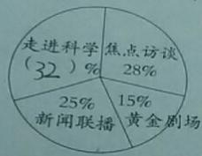

# Mathematics (Grade 6)

**ID**: a7846bdc
**难度**: hard
**题型**: short_answer

## 题目
下图是实验小学老师喜欢看的电视节目人数统计图．
 （1）实验小学喜欢《走进科学》栏目的老师占百分之几？
 （2）喜欢《黄金剧场》的老师比喜欢《新闻联播》少10人，实验小学一共有多少老师？
 （3）喜欢《焦点访谈》和喜欢《走进科学》的一共有多少人？

 走近科学（    ）%
 焦点访谈28%
 新闻联播25%
 黄金剧场15%

## 解答

**答案**: 32%, 100(人), 60(人)

1. Step1:计算实验小学喜欢《走进科学》栏目的老师所占百分比，用1减去《焦点访谈》、《新闻联播》、《黄金剧场》所占百分比，即1 - 28% - 25% - 15% = 32%
2. Step2:计算实验小学老师总人数，已知喜欢《黄金剧场》的老师比喜欢《新闻联播》少10人，用10除以二者所占百分比的差，即10÷(25% - 15%) = 10÷10% = 100(人)
3. Step3:计算喜欢《焦点访谈》和喜欢《走进科学》的总人数，用总人数乘以二者所占百分比的和，即100×(28% + 32%) = 60(人)

## 知识点

**知识点**:
  - 

---
