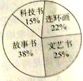

# Mathematics (Grade 6)

**ID**: a874969d
**难度**: hard
**题型**: short_answer

## 题目
下面是五年级开展的“你最喜欢的书籍”调查活动的结果统计图。(每人只选一种)

 (1)从统计图中可以清楚地看出哪种书学生最喜欢？
 (2)喜欢科技书比喜欢连环画的学生少了约百分之几？
 (3)如果五年级有学生500人，请你算出喜欢各类书籍的学生人数。
 扇形统计图中，科技书占15%，连环画占22%，文艺书占25%，故事书占38%.

## 解答

**答案**: 故事书, 7%, 190, 125, 110, 75

1. Step1:比较各类书籍所占百分比大小，38%＞25%＞22%＞15%，得出喜欢故事书的学生人数最多，答案为故事书
2. Step2:计算喜欢科技书比喜欢连环画少的百分比，22% - 15% = 7%
3. Step3:计算喜欢故事书的人数，500×38% = 190
4. Step4:计算喜欢文艺书的人数，500×25% = 125
5. Step5:计算喜欢连环画的人数，500×22% = 110
6. Step6:计算喜欢科技书的人数，500×15% = 75

## 知识点

**知识点**:
  - --

---
