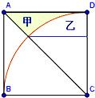

# Mathematics (Grade 6)

**ID**: ad7f9dfd
**难度**: hard
**题型**: short_answer

## 题目
在图中﹐正方形ABCD的边长是4公分﹐将以圆弧为分界的甲﹑乙两部分的面积中的大者减去小者﹐所得的差是多少平方公分﹖

## 解答

**答案**: 0.56

1. Step1:计算扇形面积，根据公式扇形面积 = 圆形面积×$\frac{1}{4}$，圆形面积为$3.14×4^{2}$，所以扇形面积为$3.14×4^{2}×\frac{1}{4}=12.56$平方公分
2. Step2:计算甲部分面积，根据甲的面积等于正方形面积的一半减去扇形面积的一半，正方形面积为$4^{2}$，则甲部分面积为$4^{2}×\frac{1}{2}−12.56÷2 = 8 - 6.28 = 1.72$平方公分
3. Step3:计算乙部分面积，根据乙的面积等于扇形面积的一半减去四分之一正方形的面积，所以乙部分面积为$12.56÷2 - 4×4×\frac{1}{4}=6.28 - 4 = 2.28$平方公分
4. Step4:计算甲乙两部分面积差，用乙部分面积减去甲部分面积，即$2.28 - 1.72 = 0.56$平方公分

## 知识点

**知识点**:
  - 组合图形的面积．

---
