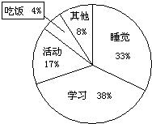

# Mathematics (Grade 6)

**ID**: aebb3c5a
**难度**: hard
**题型**: short_answer

## 题目
如图是凤凰小学六年级学生作息时间安排统计图，根据图回答下问题．
(1)一天中所用的时间最多的是______；     最少的是______．
(2)分别计算吃饭、学习、睡觉和活动所占的时间？(结果保留整数)
(3)结合图中的信息，你认为凤凰小学的作息时间安排是否合理？

## 解答

**答案**: 学习, 吃饭, 1, 9, 8, 4, 合理

1. Step1:观察扇形统计图，比较各项活动所占百分比大小，38%最大，对应学习，4%最小，对应吃饭，所以一天中所用时间最多的是学习，最少的是吃饭
2. Step2:计算吃饭所占时间，用一天的总时长24小时乘以吃饭所占百分比4%，即24×4%≈1小时
3. Step3:计算学习所占时间，用24小时乘以学习所占百分比38%，即24×38%≈9小时
4. Step4:计算睡觉所占时间，用24小时乘以睡觉所占百分比33%，即24×33%≈8小时
5. Step5:计算活动所占时间，用24小时乘以活动所占百分比17%，即24×17%≈4小时
6. Step6:根据前面计算出的吃饭、学习、睡觉、活动的时间，判断凤凰小学的作息时间安排合理

## 知识点

**知识点**:
  - 扇形统计图;从统计图表中获取信息．

---
