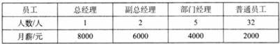

# Mathematics (Grade 6)

**ID**: afcbff78
**难度**: hard
**题型**: short_answer

## 题目
某公司全体员工工资情况如下表．

（1）这组数据的平均数、中位数和众数各是多少？
（2）你认为用哪个数据代表这个公司员工工资的一般水平比较合适？

## 解答

**答案**: 2600, 2000, 2000, 平均数

1. Step1:根据平均数计算公式，先计算工资总数为8000×1+6000×2+4000×5+2000×32 = 104000元，总人数为1+2+5+32 = 40人，再计算平均数为104000÷40 = 2600元
2. Step2:将所有员工工资数据按顺序排列，总共有40个数据，中间的两个数都是2000，计算中位数为(2000 + 2000)÷2 = 2000元
3. Step3:统计各工资出现的次数，发现2000元出现了32次，次数最多，所以众数是2000元
4. Step4:因为2000出现的次数最多，但为了更综合地反映工资水平，选用平均数代表这个公司员工工资的一般水平

## 知识点

**知识点**:
  - 小学数学;统计和概率;统计;平均数、中位数、众数;平均数、众数、中位数的异同及应用

---
