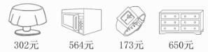

# Mathematics (Grade 6)

**ID**: b5d1e3fd
**难度**: hard
**题型**: short_answer

## 题目
商场搞活动，任意购买两件商品，总价在800元以上即可获赠遮阳伞一把，超过1000元即可获赠电热水壶一个。

（1）想要获赠遮阳伞，可以怎么买？
（2）小明的妈妈在此商场购物时获赠了一个电热水壶。你知道她买了哪两件商品吗？花了多少钱？

## 解答

**答案**: 想要获赠遮阳伞，可以买台灯和微波炉，或台灯和柜子，或手表和柜子。, 1214

1. Step1:明确获赠遮阳伞的条件是购买两件商品总价在800元以上，将各商品单价进行估算，台灯302元估算为300元，微波炉564元估算为560元，手表173元估算为170元，柜子650元不变，计算300+560=860（元），300+650=950（元），170+650=820（元），得出想要获赠遮阳伞，可以买台灯和微波炉，或台灯和柜子，或手表和柜子。
2. Step2:明确获赠电热水壶的条件是购买两件商品总价超过1000元，计算各两件商品组合的准确价格，发现564+650=1214（元），1214＞1000，得出小明妈妈买了一台微波炉和一个柜子，花费为1214元。

## 知识点

**知识点**:
  - 估算;万以内数的加减法;万以内数的大小比较

---
