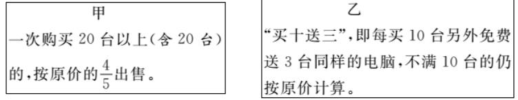

# Mathematics (Grade 6)

**ID**: b884e3ba
**难度**: hard
**题型**: short_answer

## 题目
南山小学准备买28台电脑。甲、乙两个商家每台电脑原价都是2400元。为了做成这笔生意，两商家做出如下优惠。

请你先算一算，再比一比，为学校提个建议，到哪个商家购买更便宜？

## 解答

**答案**: 53760, 52800, 乙商家便宜，故应该去乙商家购买。

1. Step1:计算在甲商家购买的总价，已知每台电脑原价2400元，购买28台，根据甲商家优惠，一次购买20台以上（含20台）按原价的$\frac{4}{5}$出售，所以总价为28×2400×$\frac{4}{5}$=53760元
2. Step2:计算在乙商家购买的总价，乙商家“买十送三”，28÷(10 + 3)=2……2，即送3×2 = 6台，那么需要付钱的台数是28 - 6 = 22台，每台2400元，所以总价为(28 - 6)×2400 = 52800元
3. Step3:比较在甲、乙两个商家购买的总价，53760＞52800，得出乙商家便宜，故应该去乙商家购买。

## 知识点

**知识点**:
  - 最佳对策问题(奥数)

---
